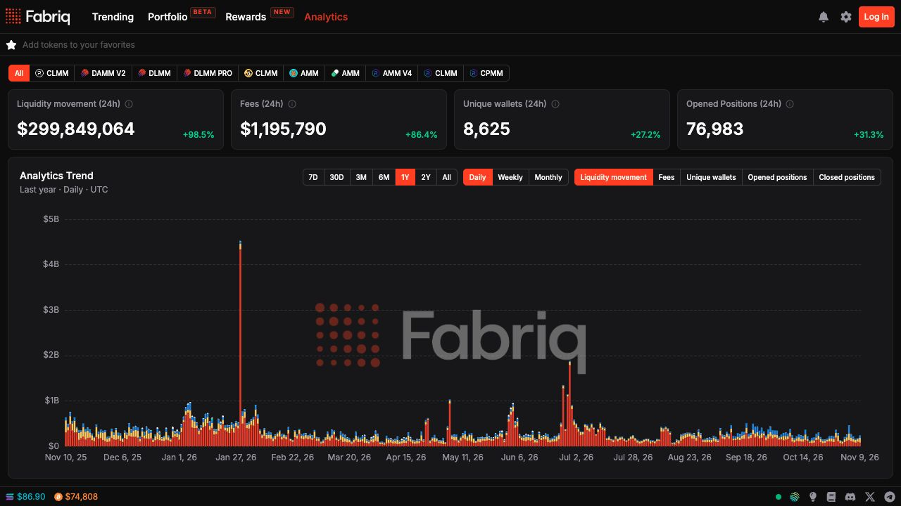

[Analytics](https://fabriq.trade/analytics) shows market-wide LP activity. Select **All** or choose individual programs to see how activity is distributed.

<Frame>
  
</Frame>

## Overview

The four summary cards show the latest 24-hour window for the selected programs and the percentage change from the preceding window.

| Metric | What it measures |
| --- | --- |
| Liquidity movement | The USD value of liquidity added plus liquidity removed. |
| Fees | The USD value of fees claimed. |
| Unique wallets | Wallets that initialized a position, added or removed liquidity, claimed fees, or closed a position. |
| Opened positions | Position initializations. |

## Program filters

| DEX | Programs |
| --- | --- |
| Byreal | CLMM |
| Meteora | DLMM, DLMM Pro, DAMM V2 |
| Orca | CLMM |
| PancakeSwap | CLMM |
| Pump.fun | AMM |
| Raydium | AMM V4, CLMM, CPMM |

## Analytics Trend

Choose a metric to chart **Liquidity movement**, **Fees**, **Unique wallets**, **Opened positions**, or **Closed positions**. The chart breaks activity down by program.

- **Time range** offers 7D, 30D, 3M, 6M, 1Y, 2Y, and All.
- **Grouping** offers Daily, Weekly, and Monthly. The chart uses UTC.
- Hover over a period to inspect the breakdown. With the chart focused, use the arrow keys to move between periods or Home and End to jump to the first or last period.
