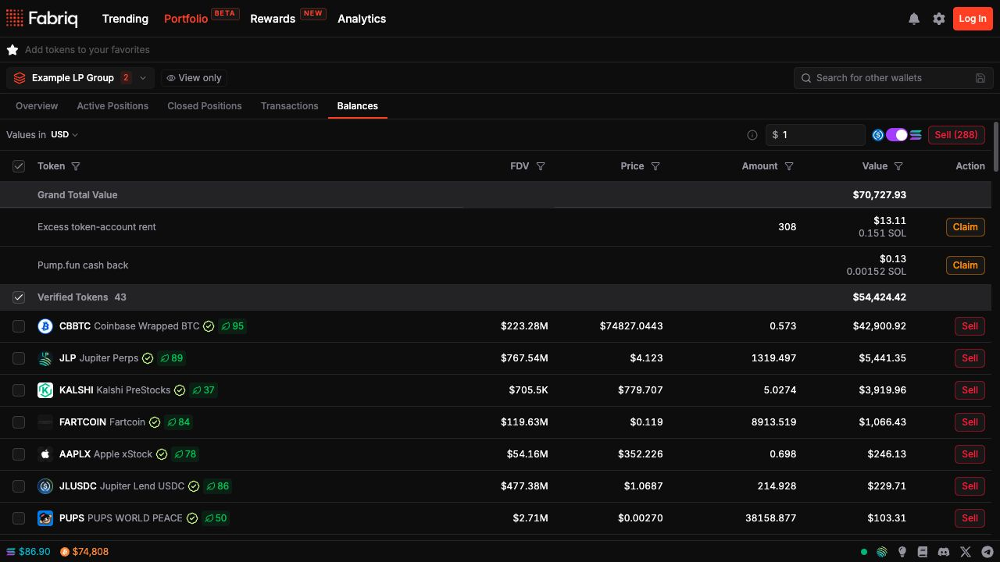

In [Portfolio](https://fabriq.trade/portfolio-beta), select **Balances** to review your holdings and sell tokens individually or in bulk. To transact, select a single wallet and connect that same wallet.

<Frame caption="Balances shows the token list, a sell threshold, and the SOL or USDC output selector.">
  
</Frame>

## Sell selected balances

<Steps>
  <Step title="Choose balances">
    Use the token filters to narrow the table by verification and risk labels, then select the rows you want to sell. Use **Sell below value** to select eligible rows below a USD threshold. Review the selected rows before continuing.
  </Step>
  <Step title="Choose an output token">
    Select SOL or USDC and choose **Sell (n)**, where **n** is the number of selected balances. For an individual token, use the row's sell action.
  </Step>
  <Step title="Review the sell status">
    Follow the **Sell tokens** dialog or the individual sell status as quotes and transactions are processed. Sign the transactions in your wallet. Bulk swaps can require more than one batch of signatures.
  </Step>
  <Step title="Close eligible token accounts">
    After processing finishes, review the close action and the estimated SOL returned. Closing eligible empty accounts is a separate step from selling.
  </Step>
</Steps>

## Unsold balances and burns

If a balance cannot be swapped, Fabriq may offer to burn the remaining tokens and close the account to recover its rent. The burn confirmation lists the affected tokens. A burn permanently destroys the listed balance and returns eligible account rent in SOL.

To close accounts that are already empty, use [SOL Reclaim](/sol-reclaim).
