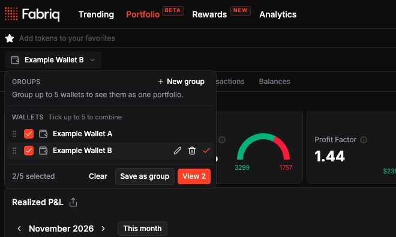
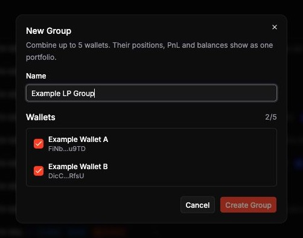
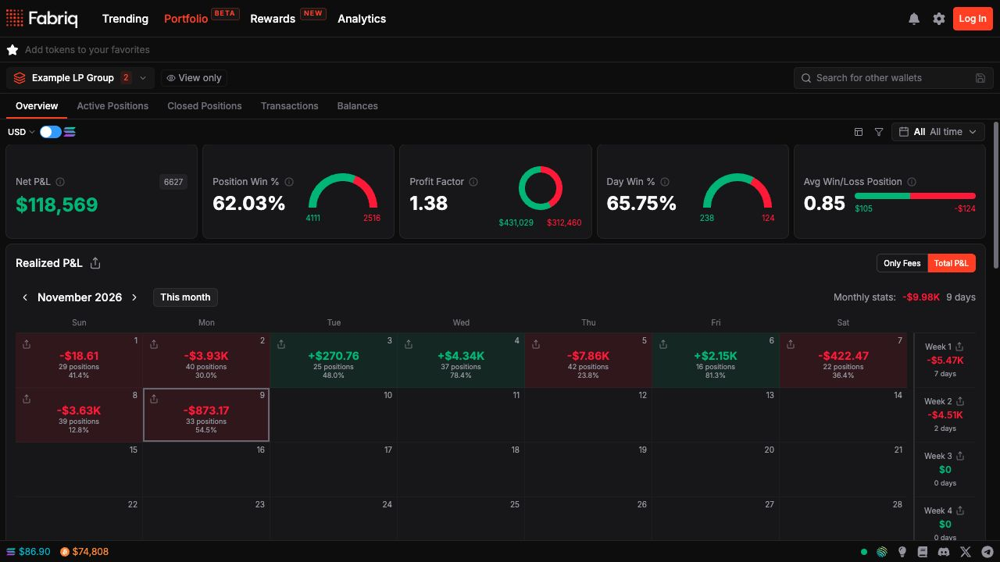
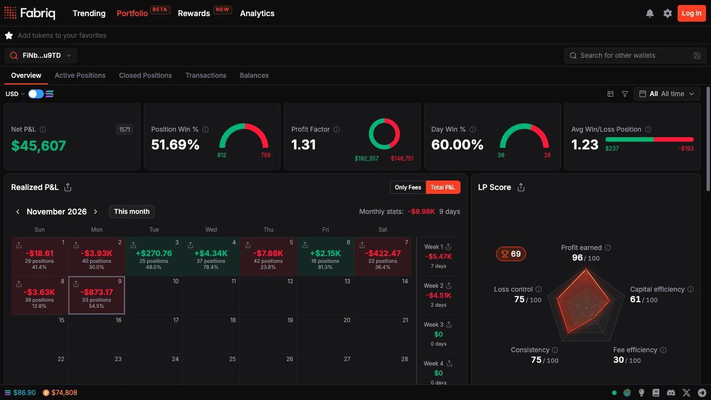
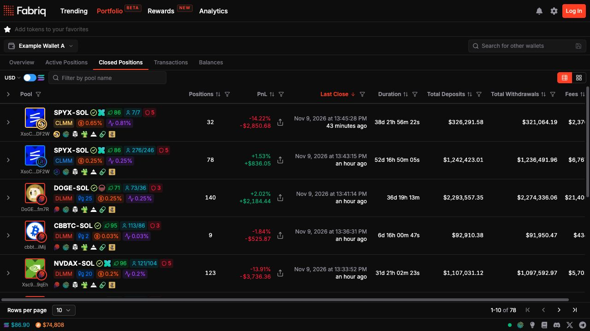
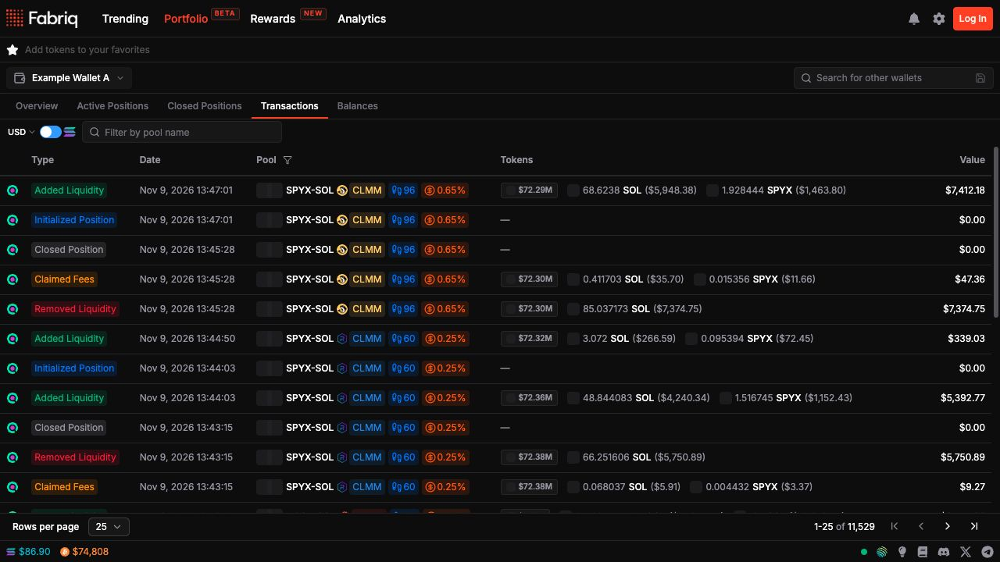

Open [Portfolio](https://fabriq.trade/portfolio-beta) to track positions, P&L, transactions, and balances. Search a public Solana address to view its portfolio without connecting a wallet.

## Wallet management

Use the wallet switcher to move between your connected wallet and saved wallets. Use the address field to open a recent search or look up another wallet. Save an address with a label for repeat tracking. You can rename, remove, and reorder saved entries.

### View several wallets together

<Steps>
  <Step title="Select wallets">
    Open the wallet switcher and tick two to five wallets. If an address is missing, save it using the address field first.

    <Frame caption="Select saved wallets, then choose View 2 or Save as group.">
      
    </Frame>
  </Step>
  <Step title="Open or save the combined view">
    Select **View** with the wallet count to open a combined portfolio. To save it, select **Save as group**, enter a name, and choose **Create Group**. You can also start with **New group** in the **Groups** section.

    <Frame>
      
    </Frame>
  </Step>
  <Step title="Review the combined portfolio">
    Combined views aggregate positions, performance, transactions, and balances. The wallet switcher shows the group name and member count.

    <Frame caption="The combined overview shows two wallets and the View only badge.">
      
    </Frame>
  </Step>
</Steps>

Saved groups can be edited, reordered, and deleted from the switcher. To claim fees, close a position, or clean up balances, select a single wallet and connect that same wallet.

## Overview

Overview shows net P&L, position and day win rates, profit factor, and average winning and losing position outcomes. It also includes the realized P&L calendar, performance metrics, P&L by pool, cumulative and period charts, and a summary of open exposure. The **LP Score** card is available for individual wallets.

<Frame caption="The Portfolio overview for Fabriq's example wallet.">
  
</Frame>

- Choose a preset or custom date range and filter by protocol or position source.
- Toggle between SOL and fiat where supported. Use the fiat currency selector to change the display currency.
- Use **Total P&L** or **Only Fees** on supported charts to review position outcomes or claimed fees.
- Select **Customize Layout** to show, hide, or reorder cards. Changes save automatically. Use **Reset layout** to restore the defaults.

### How position returns are calculated

For **Total P&L**, the return percentage is position P&L divided by the highest net funding reached during the position's lifetime. Deposits increase net funding. Withdrawals, claimed fees, and claimed rewards reduce it. Network costs are excluded from the return calculation.

A **Low confidence PnL** warning means the position uses an estimated token price from its pool. Low liquidity, high fees, or limited trading can make that estimate less reliable.

## Active Positions

Open **Active Positions** to see positions grouped by pool. Switch between table and card views, or expand a pool row to inspect individual positions and activity. Depending on the pool type, you can see range status, deposits and withdrawals, pending fees and rewards, current value, and P&L.

Search by pool name or use the table filters to narrow by protocol, range status, position source, or available metrics. Use the **Active Positions Summary** in Overview to see totals across your open positions.

## Supported protocols

Portfolio tracks positions across these Solana programs. The action menu shows which transactions are available for a specific position.

| Pool family | Tracked programs | Available actions |
| --- | --- | --- |
| Meteora liquidity pools | DLMM, DAMM V2 | Claim, close, or Zap Out where available. |
| Meteora DLMM Pro | DLMM Pro | Claim and withdraw. |
| Concentrated liquidity (CLMM) | Byreal, Orca, PancakeSwap, Raydium | Claim, withdraw, and Zap Out where supported by the position. Orca and Raydium CLMM withdrawals are full withdrawals. |
| Constant product | Pump.fun AMM, Raydium CPMM and AMM V4, Heaven AMM | Withdraw supported positions. Trading fees accrue in pool reserves and are realized through withdrawals. |

## Position Actions

Select the connected wallet in **Active Positions** to use a position's **Claim** or **Close** menu. You can also select rows to claim or close eligible positions together. The bulk controls show **Claim selected** or **Close selected** when rows are selected and **Claim all** or **Close all** otherwise.

Review the action and sign in your wallet. Fabriq's standard LP fee is **8% of the fees collected**, including when an action collects fees as part of closing or zapping a position.

## Zap Out

Zap Out converts eligible position proceeds to SOL or USDC. Use the **Claim** menu to zap eligible fees while keeping the position open, or the **Close** menu to exit the position and convert the proceeds.

1. Open the action menu for the positions you want to manage.
2. Select SOL or USDC when a quote is available. Review the estimated output before signing.
3. Follow the status until the transaction confirms. Larger exits may be split into multiple transactions.

Where applicable, reward tokens are collected separately in their original form.

## Closed Positions

Review closed positions by pool, with realized P&L, close timing, deposits, withdrawals, and fees. Expand a row to inspect individual positions, or filter the list to compare outcomes across programs.

<Frame>
  
</Frame>

## PnL Cards

Use the share controls on supported active or closed positions, charts, and calendar views to create downloadable P&L cards.

## Transactions

See wallet-level LP events, including position creation and closure, liquidity additions and removals, and fee claims. Filter the feed by program or available event filters to find the activity you want to review.

<Frame>
  
</Frame>

## HawkFi support

Use the position source filters to include wallet-managed positions, HawkFi-managed positions, or both where available. HawkFi badges identify managed positions or transactions. A mixed pool row can contain positions from both sources.

## Balances

See token holdings and their estimated value. With the selected wallet connected, you can [sell individual tokens or clean up several balances](/balances-cleanup) and [recover eligible rent or Pump.fun cashback](/sol-reclaim).
