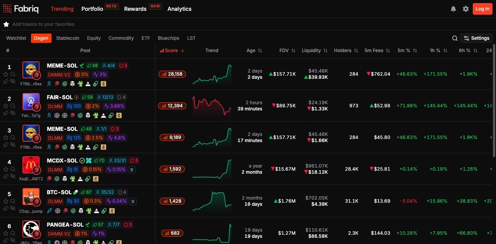

[Trending](https://fabriq.trade/trending) streams activity for Meteora DLMM and DAMM V2 pools. Use the table to compare liquidity, volume, price changes, fees, transactions, and APR across time windows.

<Frame>
  
</Frame>

## Views and Fabriq Score

- **Degen** ranks pools by short-term activity using Fabriq Score.
- **Watchlist** shows pools for tokens you've added to favorites and uses the Degen score. Star a token in the table to add it. You can also select it from the watchlist bar.
- **Category views** let you focus on token groups such as Bluechips, stablecoins, equities, commodities, or ETFs when available.

The **Trend** sparkline shows the last 30 minutes in Degen and Watchlist and the last 24 hours in category views.

## Search, filters, and views

Use the token search to find a token by name, symbol, or mint address and see its pools. To look for a specific pair, open **Settings → Filters** and enter both symbols in **Pool Name**, such as `SOL-USDC`.

Use filters to narrow the table by DEX, launchpad, pool parameters, included or excluded token mints, and metric ranges. For supported quote-fee pools, select **Fees paid in quote token**. See [Filters & Metrics](/trending-pools/filters-metrics) for the full list.

If alerts are available on your account, select **Create alert from these filters** to use the current filters as the starting point for a [pool alert](/notifications).

## Column customization

Open **Settings → Columns** to show, hide, or reorder optional columns, or restore the default layout. Select a sortable column header to change how pools are ranked.

## Interaction tools

- Hover over the table to hold the row order while values continue to update.
- Pin a pool to keep it in the pinned section.
- Use **Hide token** to remove a token's pools from the current view.

## Pool, token, and project information

Inspect a pool to see its fee structure, token details, and available project links. Token indicators can include mint and freeze authorities, Jupiter verification, or Token-2022 transfer fees. Data and badges vary by pool and token.
