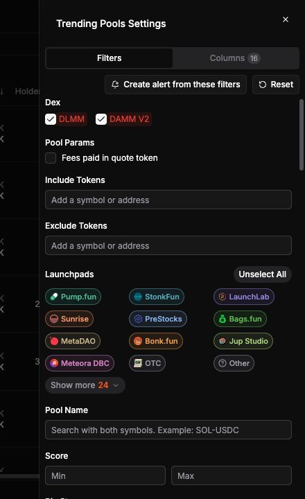

Open **Settings → Filters** in [Trending](/trending-pools) to narrow the table. Use **Reset** to clear filters and restore the default sort.

<Frame>
  
</Frame>

## Pool and token filters

| Control | What it filters |
| --- | --- |
| Dex | Meteora DLMM and DAMM V2. |
| Pool Name | The pool pair. Enter both symbols, such as `SOL-USDC`. |
| Launchpads | Tokens associated with the selected launchpads. |
| Include Tokens | Pools containing the specified token mints. |
| Exclude Tokens | Pools containing the specified token mints are filtered out. |
| Fees paid in quote token | Pools configured to pay fees in the quote token, where supported. |

Use token search to look up a token by name, symbol, or mint address and see its pools.

## Numeric filters

You can enter a minimum, a maximum, or both.

| Category | Available metrics |
| --- | --- |
| Ranking and pool structure | Score, bin step, base fee, total fee |
| Age | Token age and pool age in minutes |
| Liquidity and valuation | Pool liquidity, token total liquidity, and fully diluted valuation (FDV) in USD |
| Token signals | Holders, token organic score, and DexScreener boost |
| Time-window metrics | Volume, transactions, makers, LP fees, APR, and price change over 5m, 1h, 6h, or 24h |
| Per-minute averages | Transactions, volume, and fees per minute |

## Column controls

Open **Settings → Columns** to choose and reorder optional columns. Available columns include Score, Trend, Age, FDV, Liquidity, Holders, Yearly APR, time-window metrics, and per-minute averages.

**Yearly APR** annualizes the pool's 24-hour APR by multiplying it by 365.
